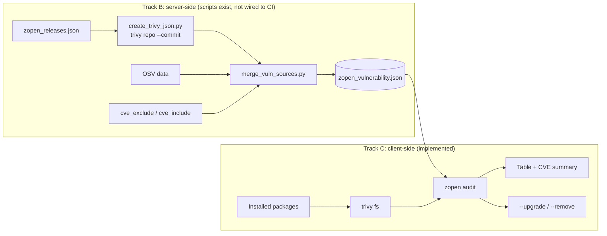

# Trivy integration in `zopen audit`

Branch: `feature/trivy-zopen-audit`. Work done 2026-11-09 to 2026-11-10 (7 commits since the merge-base with `main`).

## 1. Summary

`zopen audit` used to rely on one source: the community vulnerability cache (`zopen_vulnerability.json`, built from OSV). It now also runs the [Aqua Security Trivy](https://github.com/aquasecurity/trivy) scanner on the packages installed on the host. It merges both result sets into one report.

| | Before | After |
|---|---|---|
| Data source | Community cache only | Community cache and local Trivy scan |
| Trivy handling | None | On by default. Auto-installed if missing. Falls back to the cache if unavailable. |
| Fix information | Cache details only | `(fixed in <version>)` appended when known |
| Output | Plain columns | Bordered, wrapped table |
| Vulnerability doc | No fixed version | Fixed version shown |

## 2. What was delivered

| Component | File | Purpose |
|---|---|---|
| Client | [`bin/zopen-audit`](../bin/zopen-audit) | New flags, local Trivy scan, Trivy auto-install, table output |
| Server tool | [`tools/create_trivy_json.py`](../tools/create_trivy_json.py) | Scans each released commit with Trivy and writes zopen-schema JSON |
| Server tool | [`tools/merge_vuln_sources.py`](../tools/merge_vuln_sources.py) | Merges OSV and Trivy data, then applies the exclude and include lists |
| Tests | [`tools/tests/test_vuln_merge.py`](../tools/tests/test_vuln_merge.py) | 7 unit tests |
| Suppressions | [`data/.trivyignore`](../data/.trivyignore) | Template for documented false-positive suppressions (no active rules yet) |
| Doc tool | [`tools/create_vulnerability_doc.py`](../tools/create_vulnerability_doc.py) | Shows `(fixed in X)` in `Vulnerabilities.md` |
| Docs | [`docs/Guides/ThePackageManager.md`](Guides/ThePackageManager.md), [`CHANGELOG.md`](../CHANGELOG.md), [`docs/Guides/TrivyTaskList.md`](Guides/TrivyTaskList.md) | User docs, changelog entry, task plan |

## 3. Architecture

The design has two tracks. The client track (C) is implemented. The server track (B) has its scripts written but is not connected to CI yet.



## 4. Client: `bin/zopen-audit`

### 4.1 New options

| Option | Effect |
|---|---|
| `--trivy` | Enable the local Trivy scan. This is the default. |
| `--no-trivy`, `--skip-trivy`, `--cache-only` | Use only the community cache. |
| `--trivy-only` | Use only Trivy and skip the remote cache. Fails if Trivy cannot be installed. |
| `--trivy-severity <LIST>` | Comma-separated severities. The default is `UNKNOWN,LOW,MEDIUM,HIGH,CRITICAL`. Only letters and commas are accepted. |
| `--trivy-offline` | Run Trivy with `--skip-db-update --offline-scan`. |

### 4.2 Flow

1. **Detect Trivy.** If `trivy` is not in `PATH`, run `zopen-install -y trivy` (commit `ecfc06a41`).
2. **Handle install failure.**
   - The install output is captured. A non-zero exit code or an `ERROR` line counts as a failure.
   - A warning shows the last `ERROR` line.
   - Without `--trivy-only`, the audit falls back to the cache. With `--trivy-only`, it stops.
3. **Download caches.** Fetch the community vulnerability JSON. Skipped with `--trivy-only`.
4. **Scan each active package.** For each package:
   - If `metadata.json` is present with a `.product.release` timestamp, look up matching CVEs in the community cache. If `metadata.json` is missing or has no release timestamp, proceed directly without skipping the package.
   - Run local `trivy fs` on `${ZOPEN_PKGINSTALL}/<pkg>/<pkg>`.
5. **Merge and report.** Combine the two result sets, sort, and print the table and CVE summary.

### 4.3 The local scan

Run by `trivyScanPackage()`:

```sh
trivy fs --quiet --format json --scanners vuln \
  --severity "<list>" [--skip-db-update --offline-scan] \
  --cache-dir "${ZOPEN_ROOTFS}/var/cache/trivy" \
  --timeout 5m --output <tmp>.json  <package dir>
```

- The results are converted with `jq` into the same 3-column tab-separated format as the cache: `severity<TAB>id<TAB>details`.
- Details are built as `PkgName InstalledVersion: Title`, plus `(fixed in X)` when Trivy reports a fix.
- Trivy `UNKNOWN` severity is mapped to `LOW`.
- Cache entries also gain `(fixed in X)` when the cache provides a `fixed_version`.
- The temporary file is `${TMPDIR:-/tmp}/zopen-audit-trivy.$$.<pkg>.json`, and it is removed after each scan.
- If a scan fails for one package, the package is skipped. Other packages are still scanned.

### 4.4 Output

```
+------------------+------------+----------------------+----------------------------------------------+
| Package          | Severity   | ID                   | Details                                      |
+------------------+------------+----------------------+----------------------------------------------+
| curl             | HIGH       | CVE-2024-XXXX        | curl 8.5.0: Example description (fixed in    |
|                  |            |                      | 8.6.0)                                       |
+------------------+------------+----------------------+----------------------------------------------+
```

- The Details column dynamically stretches to fill the remainder of the terminal width (with a minimum of 20 characters), allowing the entire table to fit the screen.
- With `--upgrade`, a Status column shows `Latest`, `Resolved` or `Unresolved`.

### 4.5 Usage

```sh
zopen audit                                   # cache + Trivy (auto-installs Trivy)
zopen audit --no-trivy                        # cache only
zopen audit --trivy-only                      # Trivy only
zopen audit --trivy-severity HIGH,CRITICAL    # filter Trivy findings
zopen audit --trivy-offline                   # no Trivy DB update
zopen audit --upgrade                         # offer upgrades; shows resolved/unresolved
zopen audit --remove                          # offer removal of vulnerable packages
```

## 5. Server side

### 5.1 `create_trivy_json.py`

- **Input:** `zopen_releases.json`, from a URL or a file.
- **Scan:** For each release, run `trivy repo https://github.com/zopencommunity/<pkg> --commit <sha> --scanners vuln`.
  - Concurrency is set with `--jobs`, and the default is 4.
  - The per-release timeout is set with `--timeout`, and the default is 300 s.
  - Subprocesses use `shell=False`.
- **Output schema:** `project → release timestamp → {release_name, commit_sha, CVEs[]}`. Each CVE entry has `id`, `details` (capped at 300 characters), `published`, `severity`, `package`, `installed_version`, `fixed_version` and `source: "trivy"`.
- **Cache:** An optional `--cache-file` keyed on `project:commit:trivy_version_dbdate` avoids re-scanning unchanged commits.
- **Fail-soft:** A timeout, bad JSON or empty output skips that release.
- **Writes:** Output is written atomically.
- **Suppressions:** `--ignorefile` passes a `.trivyignore` file to Trivy.

### 5.2 `merge_vuln_sources.py`

- **Merge key:** project, then release, then CVE id.
- **Same CVE in both sources:**
  - The higher severity wins.
  - OSV details are kept.
  - `package`, `installed_version` and `fixed_version` are filled from Trivy first.
  - `source` is set to `osv,trivy`.
- **One source only:** The entry is kept and tagged `osv` or `trivy`.
- **Filters:** `cve_exclude.json` is applied first, matching by id and optionally by version. Then `cve_include.json` adds manual entries with `source: "manual_include"`.
- **Empty releases:** Releases with no CVEs are dropped.
- **No Trivy file:** If the Trivy file is missing or unreadable, the result is the OSV data alone.

## 6. Validation done

| Check | Result |
|---|---|
| `python3 -m unittest tests.test_vuln_merge` | 7 tests, all passed |
| `sh -n bin/zopen-audit` | Syntax OK |
| `shellcheck` | Not installed on this machine, so not run |
| End-to-end `zopen audit` on z/OS | Not run here |

The tests cover severity mapping, higher-severity selection, CVE merging, dataset merging, exclude and include rules, fail-soft behavior and atomic writes.

## 7. Open items and risks

These are worth stating when presenting.

1. **CI/CD is not wired up.**
   - Nothing under `.github/` or `cicd/` calls `create_trivy_json.py` or `merge_vuln_sources.py`.
   - Today the Trivy data in `zopen audit` comes only from the local scan.
   - The cached `zopen_vulnerability.json` does not yet include Trivy findings.
2. **`--trivy-only` does not work with `--upgrade`.**
   - In `--trivy-only` mode the cache download is skipped.
   - The `--upgrade` check for the latest-releases cache then stops the audit with `Latest releases json cache file not found.`
   - The latest-release CVE lookup also needs the vulnerability cache.
3. **Duplicates between sources.**
   - Cache and Trivy results are merged with `sort -u` on the whole line.
   - The same CVE can appear twice if the two sources word the details differently.
   - The server-side merge script de-duplicates by CVE id, but the client does not.
4. **Unreachable `exit 1`.**
   - `printError` already exits with code 4.
   - The `exit 1` after the `--trivy-only` error and after the invalid-severity error never runs.
   - The actual exit code is therefore 4.
5. **Coverage depends on what Trivy can read.** The local scan uses `trivy fs` on the installed package directory. Findings depend on the manifests and metadata Trivy can detect there. The false-positive and false-negative rate has not been measured.
6. **Docs lag the code.**
   - [`ThePackageManager.md`](Guides/ThePackageManager.md) shows `--trivy` as opt-in, but Trivy is now on by default.
   - The `printHelp()` text has no example for the Trivy flags.
   - All boxes in [`TrivyTaskList.md`](Guides/TrivyTaskList.md) are still unchecked, although much of Track C is done.
   - The CHANGELOG entry sits under "February 2025".
7. **Trivy version pinning and checksums** (task P0.1) are not done. Neither is the man page update.
8. **Table layout.** Package names longer than 16 characters, and IDs longer than 20, break the column alignment.

## 8. Suggested next steps

1. Wire both scripts into the nightly workflow. Add Trivy DB caching and fail-soft behavior.
2. Fix `--trivy-only --upgrade`, either by downloading the latest-releases cache anyway or by rejecting the combination clearly.
3. De-duplicate by CVE id on the client.
4. Update the help text, `ThePackageManager.md`, the man page and the task list.
5. Run `shellcheck` and an end-to-end test on z/OS.
